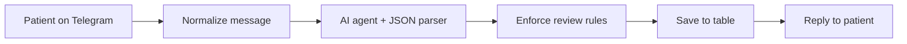

# AI Clinic Receptionist

A Telegram assistant that turns a patient's message into a structured appointment request for a human receptionist. It never confirms a booking and never gives medical advice.

**Stack:** n8n, Google Gemini (AI agent with structured output), Telegram, n8n Data Table

## Screenshots

**Workflow in n8n**

**Patient conversation on Telegram (demo data only)**

## What it does

1. A patient sends a message to the clinic's Telegram bot.
2. The AI agent extracts: patient name, phone, department, preferred date and time, a short request summary, and anything missing.
3. The request is saved to an `Appointment Requests` table for the receptionist to review.
4. The patient gets a short reply asking only for missing details and saying the clinic will confirm.

## Safety design

- **Human always decides.** After the AI answers, a rule node forces `human_review_required = true` and `booking_status = PENDING_RECEPTIONIST_CONFIRMATION`, so the AI cannot confirm an appointment even if its output says so.
- **Strict output format.** A JSON schema makes the agent return the same fields every time.
- **No medical advice.** The prompt forbids diagnosing, prescribing and interpreting results, and routes urgent symptoms to emergency instructions with priority `URGENT_REVIEW`.
- **Untrusted input.** The prompt tells the agent to ignore instructions inside patient messages that try to change its rules.
- **No invented data.** Missing details are listed, not guessed.

## Setup

1. Create an n8n Data Table named `Appointment Requests` with columns: `patient_name, phone, department, preferred_date, preferred_time, request_summary, missing_information, priority, booking_status, telegram_chat_id, received_at`.
2. Import `workflow.json`, connect Telegram and Gemini credentials, and select your table in the Save node.
3. Activate the workflow.

## Limitations

- It does not check real clinic schedules, so it never promises availability.
- It handles appointment requests only; general clinic questions need an approved knowledge base added to the prompt.
- Use fake patient data for demos. Real patient data needs the clinic's privacy and security review.
