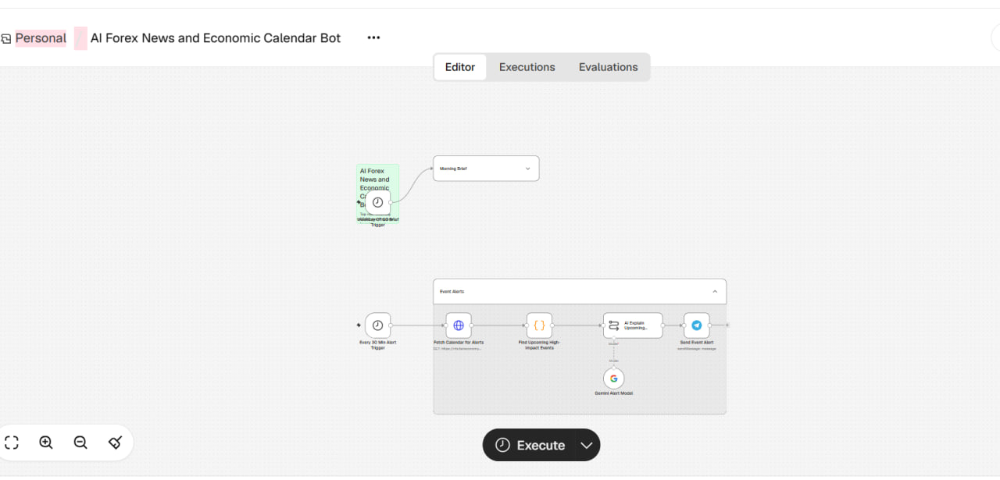
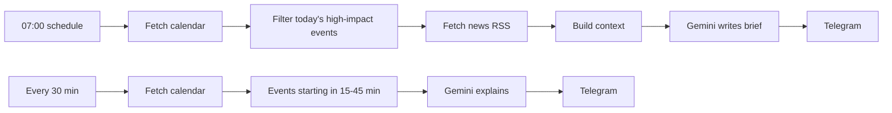

# AI Forex News and Economic Calendar Bot

A Telegram bot that sends a short market brief every weekday morning and a heads-up before high-impact economic releases, so a trader is not surprised by a volatile news spike.

**Stack:** n8n, Google Gemini, Telegram Bot API, REST/RSS data feeds

## Screenshots

**Workflow in n8n**

**Morning brief received on Telegram**

## What it does

- **Morning brief (Mon-Fri, 07:00 Addis Ababa time):** fetches this week's economic calendar, keeps today's high-impact events, adds the latest forex headlines, and has Gemini write a short brief: market mood, key events with forecast vs previous, major pairs each event can affect, and a risk reminder.
- **Event alerts (every 30 minutes, Mon-Fri, 07:00-21:30):** if a high-impact event starts in 15 to 45 minutes, Gemini writes a short alert and sends it to Telegram. If nothing is coming up, nothing is sent.

## Design decisions

- **No duplicate alerts without a database.** The alert window (15 to 45 minutes) is exactly as wide as the polling interval (30 minutes), so each event falls into one run only.
- **The AI only explains data it is given.** Prompts forbid inventing numbers, forecasts or price direction, and every message ends with a not-financial-advice line.
- **Timezone handled in code.** Event times are converted to Africa/Addis_Ababa so "today" matches the trader's day.
- **Telegram-safe output.** The AI is told to avoid the characters < > and &, which Telegram's default HTML mode would reject.
- **Resilient to a bad news source.** During testing the first news feed returned HTTP 403. I switched to a Google News RSS search and set the news node to continue on error, so the brief still sends with calendar data if the feed fails.

## Setup

1. Import `workflow.json` into n8n.
2. Connect Google Gemini and Telegram credentials.
3. Put your Telegram chat ID in the two Telegram nodes (`YOUR_TELEGRAM_CHAT_ID`).
4. Set the workflow timezone and activate it.

## Limitations

- The economic calendar comes from a free, unofficial weekly JSON feed. It can change or go down.
- The alert trigger runs about 32 times a day on weekdays, which counts toward n8n execution limits.
- The bot gives information only. It does not give trade signals.
