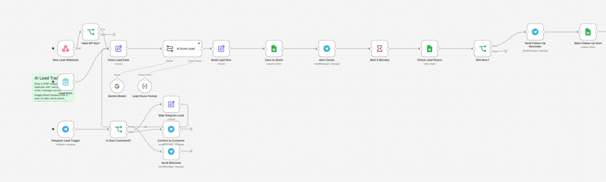
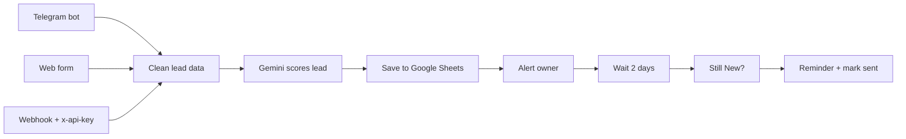

# AI Lead Tracker with Follow-Up

A small-business tool that captures customer enquiries from three places, scores each one with AI, saves it to a spreadsheet, alerts the owner on Telegram, and reminds the owner if the lead is still not contacted after two days.

**Stack:** n8n, Google Gemini, Google Sheets, Telegram Bot API

## Screenshots

**Workflow in n8n**



**Lead alert received on Telegram (demo data)**


## What it does

1. **Three ways in:** a Telegram bot (customers message the bot), a web form, and a webhook for other apps.
2. **Clean the data:** every source is mapped to the same fields: name, phone, email, message, source.
3. **AI scoring:** Gemini rates the lead Hot, Warm or Cold with a reason, and drafts a 2-sentence reply in the lead's own language using only the business info in the prompt.
4. **Save and alert:** the lead is added to Google Sheets and the owner gets a Telegram alert (🔥 for Hot leads) with the suggested reply.
5. **Follow-up:** after a wait, the workflow re-reads the lead's row. If the status is still `New`, it sends a reminder and marks `followup_sent = Yes`. Changing the status to `Contacted` stops the reminder.



## Reliability and security

- **Webhook key check:** the webhook requires an `x-api-key` header. Requests with a wrong or missing key are ignored.
- **AI failure does not lose leads:** if scoring fails, the lead is still saved as `Unscored`.
- **Error alerts:** the workflow is connected to a separate error workflow that sends a Telegram message with the failed node and a link to the execution.
- **No invented facts:** the prompt tells the AI to use only the business info provided.

## Example webhook request

```bash
curl -X POST https://YOUR-N8N-HOST/webhook/new-lead \
  -H "Content-Type: application/json" \
  -H "x-api-key: YOUR_SECRET_KEY" \
  -d '{"name":"Test Lead","phone":"+251900000000","message":"How much is a haircut?","source":"Website"}'
```

## Setup

1. Create a Google Sheet with these headers in row 1: `lead_id, date, name, phone, email, message, source, score, reason, suggested_reply, status, followup_sent`.
2. Import `workflow.json` into n8n and connect Telegram, Gemini and Google Sheets credentials.
3. Select your sheet in the three Google Sheets nodes and set `YOUR_TELEGRAM_CHAT_ID`.
4. Set your own secret in the `Valid API Key?` node.
5. Edit the business info lines in the `AI Score Lead` prompt, then activate the workflow.

## Limitations

- Telegram leads only have a username or Telegram ID, not a phone number.
- The AI reply goes to the owner, not directly to the customer.
- The webhook key is stored in the workflow. For production, use an n8n Header Auth credential instead.
